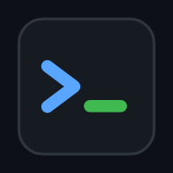

# Remota

スマホから Claude Code / Codex などの AI コーディングエージェントを操作するための、**セルフホスト型ターミナル（PWA）**。
課金・アカウント登録・広告・テレメトリは一切なし。自分のマシンで動かし、スマホのブラウザで開くだけで使えます。



## 主な機能

### 複数の機器をまとめて管理（ハブなし）
- 自宅の Mac、会社の Linux、GPU サーバー…と**何台でも登録**し、1つの画面で全セッションを機器ごとに一覧
- **中継サーバーなし**: スマホが各機器へ直接つなぐ。どの機器が止まっても、他の機器はそのまま使える
- 機器リストとトークンはスマホ側に保存。書き出し / 読み込みで別の端末へ移せる
- 承認待ちのある機器が一番上に。オフラインの機器は理由付きで表示
- 通知もスマホが持つ鍵で各機器から直接届く（通知の許可は1回、全機器に自動登録）

### 途切れない（耐久性）
- **tmux で永続化**: スマホのスリープ・回線切替・**サーバー再起動**でもセッションは消えない
- **差分再開**: 再接続時は「切れた位置から先の出力」だけを受信。画面が再描画されず一瞬で復帰
- **入力を失わない**: 切断中に打った入力はキューに貯めて再接続後に送信。サーバー側で番号管理し、**二重実行もしない**
- **死んだ接続を即検知**: 3秒ごとの生存確認で、iOS で起きがちな「繋がっているように見えて実は切れている」状態を数秒で復旧。アプリ復帰時・オンライン復帰時は即再接続
- **転送量の削減**: 細切れの出力をまとめて送信＋WebSocket 圧縮（モバイル回線向け）
- 下書きは端末に自動保存（アプリを閉じても消えない）

### 操作性
- **承認ボタンを自動生成**: 画面に出た「Do you want to proceed? 1. Yes / 2. … / 3. No」や `[y/N]` を読み取り、ワンタップのボタンとして表示
- **セッション切替**: タイトルをタップして一覧から切替。他のセッションが承認待ちになると、戻るボタンのバッジとアプリ内通知でお知らせ
- **ジェスチャー**: スワイプで慣性スクロール（tmux の履歴も）、**2本指ピンチで文字サイズ変更**、「最新へ↓」ボタン
- **テキスト選択画面**: 履歴全体をネイティブのテキストとして表示し、普通に選択・コピーできる
- キーバー（Esc / ⇧Tab / Ctrl / ^C / 矢印 / ⌫ / 1・2・3 / y・n / PgUp など、**長押しでリピート**、自由に編集可）
- 定型文のワンタップ送信、送信履歴
- テーマ（Midnight / Dracula / Solarized / Light）、触覚フィードバック（対応端末）

### 入力
- **入力欄モード（既定）**: IME・予測変換・音声入力で文章を整えてから送信。ターミナルをタップしてもキーボードが勝手に出ない
- **直接入力モード**: ⌨ ボタンで切替。vim などで1文字ずつ打ちたいとき用
- 複数行はブラケットペーストで「1メッセージ」として送信
- ↑ボタン長押しで「Enter なし送信」、空で送信すると Enter のみ
- 音声入力（Web Speech API / キーボードのマイク）
- 画像・ファイル添付（貼り付けにも対応）→ パスを入力欄に挿入してエージェントに渡せる

### 通知
- Web Push（iOS 16.4+ のホーム画面アプリ / Android / PC）＋ ntfy・任意 Webhook
- 出力からの自動判定（承認待ち / 完了）と Claude Code フック連携。通知タップで該当セッションを開く

## 必要なもの

- Node.js 18 以上（ビルドツール: macOS は Xcode CLT、Linux は `build-essential` と `python3` — node-pty のビルドに使用）
- tmux（推奨。無くても動くが、サーバー再起動でセッションが消える）

## セットアップ

```bash
git clone https://github.com/Chiytako/remota.git
cd remota
npm install
npm start          # または: node bin/remota.js
```

起動するとログイン用 URL と QR コードが表示されます。スマホで読み取って開き、
**共有 → ホーム画面に追加** するとアプリとして使えます。

グローバルコマンドとして使う場合は `npm link` を実行すると `remota` コマンドが使えます。

### 複数の機器を登録する

1. 管理したい各機器で Remota を起動します（`npm start`）。起動時に `http://…:7681/#token=…` 形式の URL と QR コードが表示されます（あとから `remota url` でも表示可）。
2. 1台目はその URL / QR をスマホで開き、「ホーム画面に追加」します。
3. 2台目以降は、アプリ右上の機器アイコン → 「機器を追加」に、その機器の URL を**トークン付きのまま貼り付け**ます。追加時に接続とトークンを確認します。

```
          ┌──▶ 機器A（自宅Mac）
スマホ ───┼──▶ 機器B（GPUサーバー）     各機器に直接接続。中継役の機器はなし
          └──▶ 機器C（会社PC）
```

- アプリ本体はスマホにキャッシュされるので、最初に開いた機器が止まっていても起動し、他の機器を操作できます。
- 機器リストはアプリを開いた URL ごとにスマホへ保存されます。別のスマホやブラウザへは、機器の管理画面の「書き出し」→「読み込み」で移せます（トークンを含むので取り扱いに注意）。
- アプリを HTTPS で開いた場合、ブラウザの制約で http:// の機器には接続できません。全機器を同じ方式（Tailscale serve での HTTPS 推奨）にそろえてください。

#### 通知の仕組み
iOS のプッシュ通知は「購読時の鍵で署名された通知」しか受け付けません。Remota ではスマホ側で鍵を作り、通知を有効にしたときと機器を追加したときに各機器へ渡します。どの機器もその鍵で署名してスマホへ直接通知します。

### 外出先から使う（推奨: Tailscale）

ポート開放はせず、[Tailscale](https://tailscale.com/) などの VPN 経由で接続してください。
iOS のプッシュ通知とクリップボードには **HTTPS** が必要です。Tailscale なら次の1行で HTTPS 化できます。

```bash
tailscale serve --bg 7681
# → https://<マシン名>.<tailnet>.ts.net/ でアクセス
```

自前の証明書を使う場合は設定ファイルの `tls.cert` / `tls.key` にパスを指定します。

### 通知を確実にする（Claude Code フック）

出力からの自動判定に加えて、Claude Code のフックから通知させると取りこぼしがありません。

```bash
remota hooks   # ~/.claude/settings.json に貼る JSON を表示
```

Remota 内で起動したセッションには `REMOTA_SESSION` 環境変数が入っているため、通知タップで該当セッションが開きます。
フックは任意のスクリプトからも使えます: `remota notify "ビルド完了" --title CI`

### ntfy / Webhook

設定ファイルの `webhookUrl` に `https://ntfy.sh/<自分のトピック>` を入れると ntfy アプリにも通知されます。
それ以外の URL には `{ title, body, sessionId }` の JSON を POST します。

## 設定

設定ファイル: `~/.config/remota/config.json`（初回起動時に自動生成。トークンと VAPID 鍵もここに保存）

| キー | 既定値 | 説明 |
| --- | --- | --- |
| `host` / `port` | `0.0.0.0` / `7681` | 待ち受けアドレス |
| `tmux` | `"auto"` | `true` / `false` / `"auto"`（インストール済みなら使う） |
| `defaultCwd` | ホーム | 新規セッションの既定ディレクトリ |
| `idleSeconds` | `8` | 出力が止まってから「完了」とみなすまでの秒数 |
| `webhookUrl` | `""` | ntfy または任意の Webhook |
| `presets` | Shell / Claude Code / Codex | 新規セッション画面の起動プリセット |
| `tls` | 空 | HTTPS 用の証明書・鍵のパス |

環境変数 `REMOTA_PORT` `REMOTA_HOST` `REMOTA_TOKEN` `REMOTA_TMUX` `REMOTA_HOME` で上書きできます。

### PC から同じセッションに入る

```bash
tmux -L remota ls
tmux -L remota attach -t remota_<id>
```

## セキュリティ

- アクセスにはランダム生成のトークンが必要。アプリは各機器のトークンを毎回明示的に送る（WebSocket はサブプロトコルで送信し、サーバーはトークンを返さない）
- 自動送信される Cookie での接続は同一オリジンのみ許可（他サイトからの乗っ取り対策）。認証失敗は IP ごとにレート制限
- **このアプリはシェルへのフルアクセスを提供します。** インターネットへ直接公開せず、VPN（Tailscale 等）経由で使ってください
- トークンの再発行: `remota token --rotate`

## 開発

```bash
npm test
```

構成:

```
bin/remota.js      CLI（start / url / token / notify / hooks）
src/server.js      HTTP API・WebSocket・認証・アップロード
src/sessions.js    PTY / tmux セッション管理、状態判定と通知のトリガー
src/detect.js      出力から「承認待ち」「作業中」を推定
src/notify.js      Web Push と Webhook
public/            PWA（xterm.js、Service Worker、マニフェスト）
```

## ライセンス

MIT
